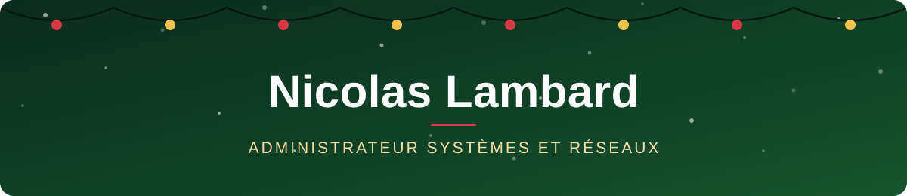

<!-- HEADER -->

  

  

  Touche-à-tout, du serveur Linux au code qui tourne dessus. 
  J'aime comprendre comment les choses marchent, et automatiser tout ce qui se répète.

  &nbsp;
  

 

<!-- CE QUE JE FAIS -->
<h2 align="center">Ce que je fais</h2>

  Installation et administration de serveurs Linux et Windows Server, physiques ou virtualisés 
  Sécurisation et durcissement des serveurs, des accès et des services exposés 
  Réseau, DNS, certificats et passage en HTTPS 
  Développement d'applis web, desktop et mobiles, du back-end à l'interface 
  Rétro-ingénierie de binaires, de jeux Unity et d'applis Android 
  Automatisation en Bash, PowerShell et Python, rédaction de procédures

 

<!-- COMPETENCES -->
<h2 align="center">Compétences</h2>

<table>
  <tr>
    <td><b>Systèmes</b></td>
    <td><code>Debian</code> <code>Ubuntu</code> <code>Windows Server 2022</code> <code>Active Directory</code> <code>Comptes, groupes et UAC</code> <code>Permissions NTFS</code> <code>Bureau à distance (RDP)</code> <code>Proxmox VE</code> <code>VMware</code> <code>Docker</code> <code>Serveurs dédiés OVHcloud</code></td>
  </tr>
  <tr>
    <td><b>Web et services</b></td>
    <td><code>Apache</code> <code>NGINX</code> <code>IIS 10</code> <code>PHP-FPM</code> <code>systemd</code> <code>pm2</code></td>
  </tr>
  <tr>
    <td><b>Réseau</b></td>
    <td><code>DNS (A, NS, TTL)</code> <code>Cloudflare</code> <code>API OVHcloud et Cloudflare</code> <code>Agrégation LACP</code> <code>WireGuard</code> <code>OpenVPN</code> <code>OpenSSH / SFTP</code> <code>Wireshark</code></td>
  </tr>
  <tr>
    <td><b>Sécurité</b></td>
    <td><code>nftables / ufw</code> <code>Pare-feu Windows Defender</code> <code>Edge Network Firewall OVHcloud</code> <code>Fail2ban</code> <code>CrowdSec</code> <code>Durcissement Windows et Linux</code> <code>Moindre privilège</code> <code>Sauvegardes chiffrées</code></td>
  </tr>
  <tr>
    <td><b>Certificats et TLS</b></td>
    <td><code>Let's Encrypt (ACME, dns-01)</code> <code>Certify The Web</code> <code>HTTPS, SNI et HSTS</code> <code>Qualys SSL Labs</code> <code>IIS Crypto</code></td>
  </tr>
  <tr>
    <td><b>Rétro-ingénierie</b></td>
    <td><code>Ghidra</code> <a href="https://github.com/morluto/rea"><code>REA</code></a> <code>Wireshark</code> <code>Unity IL2CPP</code> <code>Cpp2IL</code> <code>ARM64</code> <code>ADB</code> <code>Analyse mémoire</code> <code>Windows Driver Kit</code></td>
  </tr>
  <tr>
    <td><b>Langages</b></td>
    <td><code>Bash</code> <code>PowerShell</code> <code>Python</code> <code>PHP</code> <code>JavaScript</code> <code>TypeScript</code> <code>Java</code> <code>Kotlin</code> <code>C</code> <code>C++</code> <code>C#</code> <code>Lua</code></td>
  </tr>
  <tr>
    <td><b>Frameworks</b></td>
    <td><code>Laravel</code> <code>Livewire</code> <code>Node.js</code> <code>React</code> <code>Next.js</code> <code>Tailwind</code> <code>Vite</code> <code>Electron</code> <code>Compose Multiplatform</code></td>
  </tr>
  <tr>
    <td><b>Bases de données</b></td>
    <td><code>MySQL</code> <code>MariaDB</code> <code>PostgreSQL</code> <code>SQLite</code></td>
  </tr>
  <tr>
    <td><b>Outils</b></td>
    <td><code>Git</code> <code>Uptime Kuma</code> <code>GLPI</code> <code>FileZilla</code> <code>WinSCP</code></td>
  </tr>
</table>

 

<!-- FOOTER -->

  

  

